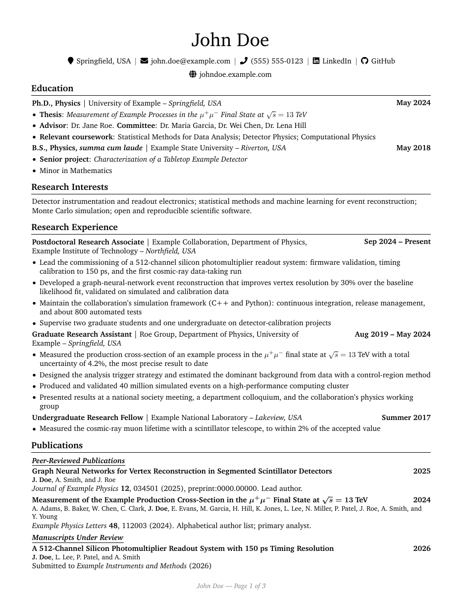

# LaTeX CV template

A LaTeX CV in which every entry (a job, a degree, a paper, a talk) is written once as a data record and printed by a shared macro. The main file only chooses which entries appear and in what order, so you never type spacing or layout by hand.

The sample content is a fictional John Doe. The built sample is [`cv_master.pdf`](cv_master.pdf).



## Requirements

- pdfLaTeX and latexmk from **TeX Live 2023 or newer**. The record engine uses recent expl3, and older releases stop with "Undefined control sequence".
- These LaTeX packages, all part of a full TeX Live install: `fontawesome5`, `charter`, `paracol`, `titlesec`, `enumitem`, `eso-pic`, `lastpage`, `changepage`, `needspace`, `bookmark`. On a minimal install, `fontawesome5` is the one most often missing.
- `make` is optional. If `pdfinfo` (poppler) is installed, `make` uses it to count pages.
- `make test` also needs `pdftotext` (poppler) and `timeout` (coreutils).

## Quick start

```bash
make                           # builds cv_master.pdf and reports its page count
latexmk -pdf cv_master.tex     # the same build without make
```

Then:

1. Put your contact details in `00_personal.tex`.
2. Replace the John Doe records in `01_education.tex` to `08_service.tex` with your own.
3. In `cv_master.tex`, list the entries you want under each `\section`.

## Files

| File | Purpose |
|---|---|
| `cv_master.tex` | The main file. It selects and orders entries. |
| `00_personal.tex` | Name and contact details for the page header. |
| `00_content.tex` | Loads every data file. |
| `01_education.tex` to `08_service.tex` | The data files. They hold records only, with no layout. |
| `97_entries.sty` | The record engine. Its header comment is the full syntax reference. |
| `98_cv_extras.sty` | Page-number footer, `\subsection` style, and the `\ifshort` toggle. |
| `99_preamble.sty` | Page geometry, fonts, section headings, and the page header. |
| `tests/engine_tests.sh` | Regression tests for the record engine. |

## Records

Each `\Define...{Name}{...}` command creates the command `\Name`. A record prints nothing until a main file calls `\Name`.

The samples in this README reuse names from the sample data files. If you paste one in next to the sample data, rename it first, because a name can be defined only once.

```latex
% in a data file
\DefinePosition{ResearchPostdoc}{
    title    = {Postdoctoral Research Associate},
    org      = {Example Institute of Technology},
    location = {Northfield, USA},
    start    = 2024-09,
    end      = present,
    bullets  = {
        \item Lead the commissioning of a 512-channel readout system
    },
}

% in the main file
\section{Research Experience}
    \ResearchPostdoc
```

| Command | Use | Needs |
|---|---|---|
| `\DefinePosition` | Jobs, degrees, certificates, honors, memberships | `title`, a date, and bullets for each form you print |
| `\DefineCourse` | A course taught, listed under a position | `title`, a date, and bullets for each form you print |
| `\DefinePublication` | Papers and manuscripts | `title`, `authors`, `venue`, a date |
| `\DefinePresentation` | Posters and talks | `title`, `type`, `venue`, a date |
| `\DefineReference` | Referees | `name`, `affiliation`, `relationship`, `confirmed` |
| `\DefineSkills` | A block of labeled skill lines | none |
| `\DefineParagraph` | Free text, such as research interests | none |

Four rules apply to every record:

- A name uses letters only, for example `PubFirst` and not `Pub1`.
- Put braces around any value that contains a comma: `org = {Department of Physics, University of Example}`.
- For an entry with no bullets, write `bullets = none`.
- Inside a URL, write `\#` for a `#`.

### Dates

Dates are written as numbers and printed in one consistent style.

| You write | It prints |
|---|---|
| `start = 2023-01, end = 2023-12` | Jan – Dec 2023 |
| `start = 2019-08, end = 2024-05` | Aug 2019 – May 2024 |
| `start = 2024-09, end = present` | Sep 2024 – Present |
| `start = 2021, end = 2023` | 2021 – 2023 |
| `date = 2023-12` | Dec 2023 |
| `date = {Spring 2020}` | Spring 2020 (any text that is not a number prints as written) |

`start` and `end` must have the same precision: both `YYYY` or both `YYYY-MM`.

### Courses under a teaching position

```latex
\DefineCourse{CourseMechanics}{
    title = {PHYS 101, Introductory Mechanics},
    type  = {recitation},
    date  = {Fall 2020},
    bullets = { \item Two weekly recitation sections of 25 students },
}
\DefinePosition{TeachingAssistant}{
    ...,
    courses = {CourseMechanics, CourseModernLab},
}
```

The courses print below the position's bullets, indented, under "Courses taught".

### References

Each referee has `confirmed = true` or `confirmed = false`. Printing a referee with `confirmed = false` stops the build, so nobody appears on your CV before they have agreed. Until then, print `\ReferencesOnRequest`.

## Forms: one record, several documents

A record can hold more than one version of the same item. Each version is called a form, and a main file chooses the form it prints.

| Form | Meant for | Available on |
|---|---|---|
| `full` | Everything. This is the default. | positions, courses, publications, presentations |
| `acad` | A tighter version for a page-limited CV | positions, courses |
| `short` | One line, for a section a document only summarizes | positions, courses, publications, presentations |
| `tut` | Wording for a resume with a different reader | positions, courses |

Skills, paragraphs and references have a single version.

To give a form its own wording, prefix the key with the form name:

```latex
\DefinePosition{ResearchPostdoc}{
    title     = {Postdoctoral Research Associate},
    org       = {Example Collaboration, Department of Physics, Example Institute of Technology},
    short org = {Example Institute of Technology},
    start     = 2024-09,
    end       = present,
    bullets       = { \item ... \item ... \item ... },
    short bullets = { \item One line that sums up the role },
}
```

- A text field falls back to the plain key. The `short` form above uses `short org`, and it uses `title` because there is no `short title`.
- Bullets and courses do not fall back. To print a position in the `short` form, the record needs `short bullets`, which can be `none`.
- Dates are the same in every form.

In a main file, `\SetEntryForm{short}` sets the form for every entry that follows, and `\Name[short]` sets it for one entry.

To make a tailored CV, copy `cv_master.tex` to a new main file (for example `cv_short.tex`), change `\SetEntryForm` and the list of entries, and build it with `make DOC=cv_short`. The records stay shared, so a fact you correct once is corrected in every document.

## Layout settings

Set these in a main file, after `\begin{document}`:

| Command | Effect | Default |
|---|---|---|
| `\SetEntryForm{form}` | Form used by every `\Name` that follows | `full` |
| `\SetEntryGap{0.04cm}` | Space between entries | `0.10cm` |
| `\SetAuthorFont{\footnotesize}` | Size of author lists | `\small` |
| `\cvfooter` | Adds "Name — Page x of y" to every page | off |

Other behavior:

- `\shorttrue`, placed before `\begin{document}`, leaves out everything wrapped in `\ifshort\else ... \fi`.
- A publication or presentation entry never splits across two pages, and a heading stays with the entry below it.
- A header field left empty in `00_personal.tex` is not printed.
- The PDF title and author come from `\name{}`.

## Errors

The engine stops the build with a `cv-entries` error, instead of printing something wrong, when a record has:

- an unknown or repeated key, or a value with a comma that is not in braces
- a missing required key
- bullets that are empty, are not a list of `\item` lines, or are missing for the form being printed
- a date that is malformed, or an end date before the start date
- an unknown form, a name that is not letters only, or a name that already exists
- a course listed under a position that is not a `\DefineCourse` record
- a repeated skills label, or a `confirmed` value other than `true` or `false`
- a referee with `confirmed = false` that a document tries to print

The message names the record and the key. Fix the record; the error is there to catch typos.

## Make targets

```bash
make                      # build cv_master.pdf and report its page count
make DOC=cv_short         # build another main file (cv_short.tex)
make check MAX_PAGES=3    # fail if the PDF is longer than 3 pages (the sample is 3)
make test                 # 60 engine tests; run them after editing 97_entries.sty
make clean                # remove build artifacts, keep the PDF
```

## Credits and license

`99_preamble.sty` is derived from the LaTeX template generated by [RenderCV](https://github.com/rendercv/rendercv) (MIT License). This template is released under the MIT License; see [`LICENSE`](LICENSE).
